# AWS SaaS production platform: designed from failure domains

[](https://github.com/santoshmyakala/aws-saas-production-platform/actions/workflows/ci.yml)


A production AWS platform for a B2B SaaS product, written in Terraform. It starts from **requirements and failure domains**, not from a list of services. Every reliability, capacity, security and DR rule it claims is checked by a plan-time test against mocked AWS providers, so anyone can verify them without an AWS account.

| Requirement | Target | How the design meets it |
|---|---|---|
| Peak load | 3,000 RPS | API floor sized so **two of three AZs** carry peak (24 tasks); scaling on requests per task |
| Availability | 99.95% (21.6 min/month budget) | Zonal independence, canary deploys with SLO-alarm rollback, multi-window burn-rate alerts |
| Latency | p99 ≤ 400 ms | Per-hop budget, deadlines, admission control, slow work moved to a queue |
| RTO / RPO | 60 min / 15 min | Warm standby region, Aurora Global Database, Route 53 origin failover |

The full derivation is in [docs/requirements.md](docs/requirements.md).

## Failure-domain map

<picture>
  <source media="(prefers-color-scheme: dark)" srcset="docs/diagrams/failure-domains-dark.svg">
  
</picture>

<sub>Animated diagrams generated from <a href="docs/diagrams">docs/diagrams/diagrams.yaml</a> with <a href="https://github.com/santoshmyakala/santoshmyakala/tree/main/tools/archdiagram">archdiagram</a>.</sub>

Running in three AZs isn't the same as surviving the loss of one. The design removes the shared pieces that defeat multi-AZ:
- **One NAT gateway per AZ**, with per-AZ route tables. Production rejects a shared NAT at plan time.
- **VPC endpoints** for ECR, logs, Secrets Manager, SQS, KMS and STS, so image pulls and secret injection don't depend on NAT.
- **Capacity for N+1 AZs**, not "enough on a good day".
- **Deployments**, the failure that hits every AZ at once, are made gradual and self-reverting.

The full table is in [docs/failure-domains.md](docs/failure-domains.md).

## One request, and what can go wrong at each hop

<picture>
  <source media="(prefers-color-scheme: dark)" srcset="docs/diagrams/request-path-dark.svg">
  
</picture>

Each hop has a latency budget, a timeout shorter than its caller's, and a defined failure behaviour ([docs/request-path.md](docs/request-path.md)). The application side of these patterns is implemented and tested in [resilience-patterns-lab](https://github.com/santoshmyakala/resilience-patterns-lab):
- request deadlines;
- retries at one layer only, with backoff and jitter;
- circuit breakers and load shedding;
- an idempotent queue worker.

## Deployments that can't take the platform down

<picture>
  <source media="(prefers-color-scheme: dark)" srcset="docs/diagrams/deployment-dark.svg">
  
</picture>

A health check proves a task is up, not that a release is safe. ECS's built-in **canary** strategy sends 5% of traffic to the new revision. Three alarms then judge the release, and any one of them rolls it back automatically:
- the 5xx ratio crosses the fast-burn threshold;
- p99 latency goes over 400 ms;
- **RDS Proxy borrow latency** rises, which is the signature of a new slow query.

Images are accepted only when pinned by `@sha256` digest, so every rollout and rollback is exact.

## Delivered by GitHub Actions

<picture>
  <source media="(prefers-color-scheme: dark)" srcset="docs/diagrams/github-actions-dark.svg">
  
</picture>

- **`ci`:** offline tests, lint and scans on every push.
- **`plan`:** read-only plans for both environments, posted on every PR.
- **`deploy`:** staging → approval → production. Each stage applies the reviewed plan, waits for the ECS canary (which SLO alarms can roll back) and smoke-tests through CloudFront.
- **`drift`:** nightly. Raises an issue when someone changes infrastructure outside Terraform.
- **`diagrams`:** keeps these SVGs in sync with their YAML.

AWS access uses **GitHub OIDC with environment-scoped roles**, so no keys are stored anywhere. A PR can only reach the read-only role. Setup steps and the security model are in [docs/ci-cd.md](docs/ci-cd.md), and [terraform/bootstrap](terraform/bootstrap) creates the OIDC trust, state bucket and roles.

## Regional disaster recovery

<picture>
  <source media="(prefers-color-scheme: dark)" srcset="docs/diagrams/disaster-recovery-dark.svg">
  
</picture>

- **Traffic fails over automatically.** The standby serves reads immediately.
- **Promoting the database for writes is an approved decision.** Replication also copies a bad migration, so a human confirms the cause first ([runbook](docs/runbooks/regional-failover.md)).
- The choice of warm standby over pilot light and active-active is recorded in [ADR 0005](docs/decisions/0005-disaster-recovery.md).

## What the tests prove

`terraform test` runs 18 checks against mocked AWS providers, in CI on every push:

| Test | Asserts |
|---|---|
| `zonal_isolation` | 3 NAT gateways, each in its own AZ; **app subnets in AZ-x egress through NAT in AZ-x**; data tier has no internet route |
| `aws_apis_do_not_depend_on_nat` | Interface endpoints for ECR, logs, Secrets Manager, SQS, KMS, STS; S3 gateway endpoint |
| `capacity_survives_one_az_loss` | API floor = 24 tasks; 16 surviving tasks × 200 RPS ≥ 3,000 RPS; rollouts never go below 100% healthy |
| `edge_cannot_be_bypassed` | ALB admits only CloudFront's prefix list; requests without the origin header get 403; TLS 1.3 policy |
| `safe_deployments` | Canary strategy, ≤ 10% first step, three alarm-driven rollbacks, circuit breaker |
| `database_resilience` | Aurora instances in three AZs, encrypted, deletion-protected, ≥ 7-day PITR, private, TLS-only proxy with connection headroom, **no password in state** |
| `async_processing` | DLQ after 5 receives, visibility ≥ 6× worker timeout, KMS-encrypted queues |
| `least_privilege` | API can't consume jobs, worker can't enqueue, no wildcard actions, no ECS Exec |
| `slo_alerting` | Burn-rate thresholds derived from 99.95% (fast burn = 0.72% errors over 1 h + 5 min); p99 latency alarm at 400 ms |
| `standby_is_warm_not_cold` | Standby runs minimal capacity and a two-AZ DB replica, inherits credentials, alarms on RPO lag |
| `prod_rejects_shared_nat`, `rejects_mutable_image_tags` | Unsafe inputs fail at plan time |
| Root: `edge_protection`, `dns_failover`, … | WAF (rate limit, OWASP, SQLi, IP reputation), TLS 1.2+, HTTPS-only origin, failover gated by a calculated health check |

## Repository layout

```
terraform/
  main.tf · edge.tf          global DB, both regions, WAF + CloudFront, Route 53 failover
  modules/region/            one region: VPC, ALB, ECS, Aurora + RDS Proxy, SQS, KMS, IAM, alarms
  bootstrap/                 GitHub OIDC provider, encrypted state bucket, plan + deploy roles
  tests/ · modules/region/tests/   offline tests (mocked providers)
docs/
  requirements.md            requirements → constraints, error budget, capacity math
  failure-domains.md         what fails together and how it is contained
  request-path.md            latency budget and timeout per hop
  decisions/                 ADRs: failure domains first, compute, database, deployments, DR
  runbooks/                  AZ failure, regional failover, compromised task role, slow query, DLQ
  ci-cd.md                   GitHub Actions workflows, OIDC security model, how to enable deploys
.github/workflows/           ci · plan · deploy · drift · diagrams · _terraform (reusable)
```

## Run it

Offline, with no AWS account:

```bash
cd terraform && terraform init -backend=false && terraform test
```

```bash
cd terraform/modules/region && terraform init -backend=false && terraform test
```

To deploy, fill in `terraform/prod.tfvars.example` with your domain, hosted zone, ACM certificates and image digests. Pass the origin secret via `TF_VAR_origin_verify_header` from your secret store, then run `terraform apply` with a remote state backend.

> **Cost:** running this for real is a production-sized bill. That includes three NAT gateways per region, a 3-instance Aurora cluster, a 2-instance standby and about 27 Fargate tasks. Use `environment = "staging"` and smaller sizes to experiment.

## Credits

The scenario structure (failure domains → accounts → VPC → request path → compute → deployments → data → async → resilience → DR → security → observability) was inspired by a public infographic series by [@veriqta](https://www.instagram.com/veriqta/). The design, code, tests and documents here are my own.

## Licence

MIT
