# CI/CD with GitHub Actions



| Workflow | Trigger | What it does | Needs AWS? |
|---|---|---|---|
| [`ci`](../.github/workflows/ci.yml) | every push / PR | `fmt`, `validate`, **18 offline tests** (mocked providers), tflint, blocking Trivy IaC scan, gitleaks | No |
| [`diagrams`](../.github/workflows/diagrams.yml) | PR / push touching `docs/diagrams` | Regenerates the animated SVGs from YAML and fails if the committed files are stale | No |
| [`plan`](../.github/workflows/plan.yml) | PR touching `terraform/` | Plans **staging and production** with a read-only role and posts one sticky PR comment | Yes |
| [`deploy`](../.github/workflows/deploy.yml) | push to `main`, or manual with image digests | staging → **approval** → production. Each stage plans, applies *that* plan, waits for the ECS canary and smoke-tests through CloudFront | Yes |
| [`drift`](../.github/workflows/drift.yml) | nightly | Plans both environments. Opens or updates a `drift` issue if reality differs from code, and closes it when fixed | Yes |
| [`_terraform`](../.github/workflows/_terraform.yml) | called by the three above | Shared steps, so plan, deploy and drift can't diverge | — |

Until AWS is connected, `plan` and `deploy` don't fail. They post a notice in the run summary instead, and `ci` still runs every check offline.

## Security model

- **No stored AWS keys.** Jobs exchange GitHub's OIDC token for one-hour STS credentials.
- **Trust is scoped by GitHub environment** (the token's `sub` claim):

| GitHub environment | Used by | IAM role | Protection |
|---|---|---|---|
| `plan-staging`, `plan-production` | `plan`, `drift` | `gha-docflow-plan`: `ReadOnlyAccess` + state read + lock file | none needed: it can't change anything |
| `staging` | `deploy` | `gha-docflow-deploy` | deployment branch: `main` only |
| `production` | `deploy` | `gha-docflow-deploy` | `main` only **+ required reviewers** |

  A pull request can never reach the deploy role, because it can't run in the `staging` or `production` environments.
- **Applies use the saved plan** (`terraform apply tfplan`), so what was shown is what gets applied.
- **One rollout at a time:** `concurrency: deploy`, and running applies are never cancelled. State uses S3 native locking (`use_lockfile`).
- **The deploy role is broad.** Terraform creates VPCs, IAM roles and databases. In a real organisation, attach a permissions boundary and deny `iam:*` outside the `docflow-*` path.

## Enable it

1. **Bootstrap AWS** once, with admin credentials, from your machine:
   ```bash
   cd terraform/bootstrap && terraform init && terraform apply
   ```
   It creates the GitHub OIDC provider, a KMS-encrypted versioned state bucket, and the two roles. It prints the values for step 3.
2. **Create environments** under Settings → Environments:
   - `plan-staging` and `plan-production`;
   - `staging`: deployment branches = `main`;
   - `production`: deployment branches = `main`, plus required reviewers.
3. **Set repository variables:**
   - `AWS_REGION`;
   - `TF_STATE_BUCKET`;
   - `AWS_PLAN_ROLE_ARN`;
   - `AWS_DEPLOY_ROLE_ARN`;
   - `DEPLOY_ENABLED=true`.
4. **Set per-environment variables** on each of the four environments:
   - `TF_STATE_KEY`, e.g. `staging/terraform.tfstate`;
   - `TFVARS`: the contents of a tfvars file, using `prod.tfvars.example` as the template.
5. **Set a repository secret:** `ORIGIN_VERIFY_HEADER`, a 32+ character random value.
6. **Open a pull request.** The plan appears as a comment.

## Releasing a new image

The application repo's pipeline (see [resilience-patterns-lab](https://github.com/santoshmyakala/resilience-patterns-lab)) pushes a signed image and prints its digest. To roll it out:

```bash
gh workflow run deploy -f api_image=<registry>/docflow-api@sha256:<digest> -f worker_image=<registry>/docflow-worker@sha256:<digest>
```

Staging deploys first. Production waits for approval, then rolls out as a 5% canary that SLO alarms can roll back.
