# Failure-domain map

Redundancy (three AZs) isn't the same as independence. This map lists every component and what fails with it. It also records how the design contains that failure and which test or alarm proves it.

| Component | Failure domain | If it fails… | Containment | Evidence |
|---|---|---|---|---|
| ECS tasks | AZ | That AZ's capacity is lost | N+1 floor (24 tasks, 8 per AZ); ALB stops routing to unhealthy targets | test `capacity_survives_one_az_loss` |
| NAT gateway | AZ | Egress from that AZ only | One NAT per AZ, per-AZ route tables. **A shared NAT would take third-party calls down in all AZs** | test `zonal_isolation`; prod rejects `nat_mode = "single"` |
| AWS API access (ECR, logs, secrets, SQS, KMS) | Region (endpoint per AZ) | Image pulls, logging and secret injection fail | Interface endpoints in every AZ, so NAT isn't on the path | test `aws_apis_do_not_depend_on_nat` |
| ALB | Region (multi-AZ nodes) | All traffic in the region | Route 53 health check → standby region | `aws_route53_health_check.primary_alb` |
| Aurora writer | AZ | Writes pause ~30–60 s while a reader is promoted | Readers in two other AZs; RDS Proxy holds client connections during failover | test `database_resilience` |
| Database connections | Shared by all tasks | Scaling out makes latency *worse* | RDS Proxy pool cap; borrow-latency alarm; per-task pool of 10 | `db_connections` alarm |
| SQS | Region | Background processing stops; new jobs get 503 (nothing half-accepted), reads keep working | Managed multi-AZ service; DLQ isolates poison messages | test `async_processing` |
| CloudFront + WAF | Global | Every customer | Managed global service; a WAF false positive is the more likely failure, so new rules start in *count* mode | `edge.tf` |
| Deployment | Every AZ at once | A bad release reaches all AZs together, so it is *not* contained by multi-AZ | 5% canary, SLO-alarm rollback, digest-pinned images | test `safe_deployments` |
| Region | Region | Everything in it | Warm standby + Aurora Global Database + DNS failover | [runbooks/regional-failover.md](runbooks/regional-failover.md) |
| Task IAM role | Workload | An attacker acts as that workload | Least privilege per workload; API can't read the queue; worker can't enqueue; no ECS Exec | test `least_privilege`, [runbook](runbooks/compromised-task-role.md) |

## Dependencies that cross failure domains on purpose

- **CI/CD and DNS are regional or global.** That's acceptable because neither is on the request path, and the canary limits the blast radius of a bad deploy.
- **Replication also replicates mistakes.** A bad migration reaches the standby within seconds. That's why database promotion is an approved step, and why PITR (14 days) is kept independently of DR.
