# One request through the platform

Every hop adds latency, a timeout boundary, an observability gap and a dependency. The table gives each hop a **budget** (its share of the 400 ms p99) and a **failure behaviour**, so a slow dependency degrades one request instead of the platform.

| # | Hop | Budget (p99) | Timeout / limit | When it fails |
|---|---|---|---|---|
| 1 | Route 53 | 0 ms warm (cached by resolvers) | TTL 60 s on failover records | Failover record moves traffic to the standby |
| 2 | CloudFront + WAF | 1–5 ms | — | WAF blocks (403) are logged with the matching rule |
| 3 | CloudFront → ALB | 10–40 ms (edge to region) | Origin read timeout 10 s | 504 from CloudFront; counted against the SLO |
| 4 | ALB | 2–5 ms | Idle timeout 60 s | Least-outstanding-requests routing avoids a slow task |
| 5 | API task | ≤ 250 ms own work | **2 s request deadline**, at most 64 in-flight requests per task | 503 + `Retry-After` when the in-flight limit is hit (load shedding) |
| 6 | RDS Proxy | ~1 ms | Connection borrow ≤ 5 s | Fails fast; the borrow-latency alarm fires before users notice |
| 7 | Aurora | ≤ 50 ms per query | `statement_timeout` per transaction in the app | Slow queries are logged above 400 ms (`log_min_duration_statement`) |
| 8 | SQS enqueue | ~10 ms | SDK timeout 1 s, 2 attempts | The API returns 503 so the client retries; nothing is half-done |
| — | Worker | async | 30 s per message, visibility timeout 180 s | 5 attempts, then the DLQ; idempotent so redelivery is safe |

## Rules that keep the budget

1. **Deadlines shrink downstream.** Each call gets the *remaining* request deadline, not a fresh timeout.
2. **Retry in one layer only.** Clients retry with backoff; services don't add their own retries on top. Otherwise three layers of three attempts make 27 calls ([resilience-patterns-lab](https://github.com/santoshmyakala/resilience-patterns-lab) demonstrates this with tests).
3. **Anything slower than the budget goes to the queue.** Document processing, e-mails and webhooks run in the worker, so the API answers 202 within budget.
